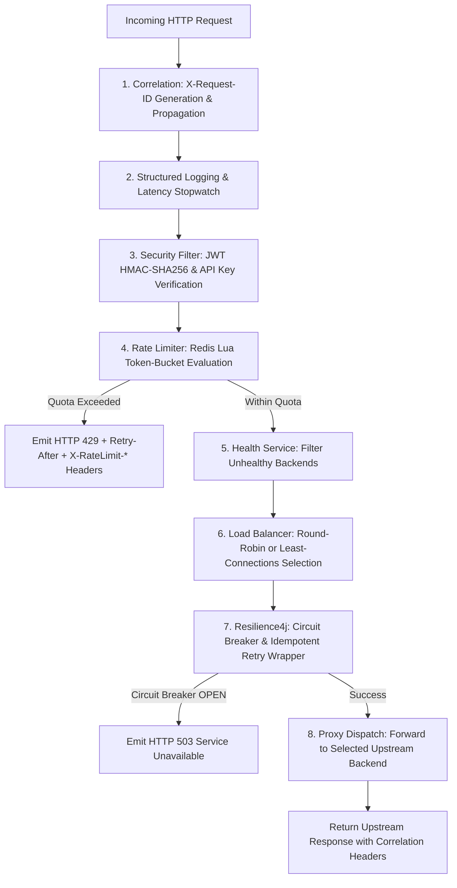

# SentinelFlow — Architecture & Design Specification 🏛️

## 1. High-Level Architecture Overview

SentinelFlow is designed as a distributed, high-throughput, and fault-tolerant API Traffic and Security Gateway. It mediates all client traffic, enforces zero-trust authentication and rate limits, dynamically balances load across healthy upstream instances, and provides sub-millisecond observability metrics.

```
                           ┌────────────────────────┐
                           │ React Monitoring Dash  │
                           │   (Port 3000 / Dark)   │
                           └───────────┬────────────┘
                                       │ HTTP / Actuator Polling
                                       ▼
    ┌──────────────────────────────────────────────────────────────────┐
    │                 Distributed API Gateway Cluster                  │
    │                                                                  │
    │   ┌────────────────┐     ┌────────────────┐    ┌─────────────┐   │
    │   │  gateway-1     │     │  gateway-2     │    │  gateway-3  │   │
    │   │  (Port 8080)   │     │  (Port 8084)   │    │ (Port 8085) │   │
    │   └───────┬────────┘     └───────┬────────┘    └──────┬──────┘   │
    └───────────┼──────────────────────┼────────────────────┼──────────┘
                │                      │                    │
                ▼                      ▼                    ▼
     ┌─────────────────────────────────────────────────────────────┐
     │           Distributed State & Token Bucket (Redis)          │
     │      - Atomic token_bucket.lua execution                    │
     │      - Rate limits: FREE (100/m), PREMIUM (1k/m), ADMIN(5k) │
     └─────────────────────────────────────────────────────────────┘
                │                      │                    │
                └──────────────┬───────┴────────────────────┘
                               │ Health-Aware Load Balancer (Round-Robin / Least-Conn)
                               │ Resilience4j Circuit Breaker (CLOSED / OPEN / HALF-OPEN)
                               ▼
    ┌──────────────────────────────────────────────────────────────────┐
    │                 Upstream Backend Microservices                   │
    │                                                                  │
    │   ┌────────────────┐     ┌────────────────┐    ┌─────────────┐   │
    │   │  backend-1     │     │  backend-2     │    │  backend-3  │   │
    │   │  (Port 8081)   │     │  (Port 8082)   │    │ (Port 8083) │   │
    │   └───────┬────────┘     └───────┬────────┘    └──────┬──────┘   │
    └───────────┼──────────────────────┼────────────────────┼──────────┘
                └──────────────────────┼────────────────────┘
                                       ▼
                       ┌────────────────────────────────┐
                       │   PostgreSQL Database Store    │
                       │   (Audit Logs & API Keys)      │
                       └────────────────────────────────┘
```

---

## 2. Request Processing Pipeline

Every incoming HTTP request traverses an 8-stage pipeline within the gateway:



---

## 3. Distributed Rate Limiting Algorithm

SentinelFlow implements the **Token-Bucket Algorithm** executed atomically via Redis Lua script (`token_bucket.lua`).

### Key Properties:
- **Zero Race Conditions**: Redis single-threaded Lua execution guarantees atomic read, refill, and token deduction.
- **Shared State**: Replicas `gateway-1`, `gateway-2`, and `gateway-3` share identical Redis key spaces, preventing quota duplication when requests hit different gateway replicas.
- **Quota Tiers**:
  - `FREE`: 100 requests per minute (refill rate: ~1.67 tokens/sec, capacity: 100)
  - `PREMIUM`: 1,000 requests per minute (refill rate: ~16.67 tokens/sec, capacity: 1,000)
  - `ADMIN`: 5,000 requests per minute (refill rate: ~83.33 tokens/sec, capacity: 5,000)
- **Rate Limit Headers**:
  - `X-RateLimit-Limit`: Maximum tier capacity.
  - `X-RateLimit-Remaining`: Tokens currently remaining in bucket.
  - `X-RateLimit-Reset`: Milliseconds remaining until bucket is fully refilled.
  - `Retry-After`: Seconds client must wait before retrying when status is `429 Too Many Requests`.

---

## 4. Backend Health Monitoring & Load Balancing

### Health Checking Algorithm:
1. The gateway executes periodic HTTP GET probes against `/health` of all configured upstream instances at 5-second intervals.
2. **Failure Threshold**: 3 consecutive failed health probes transition node status from `UP` to `DOWN`.
3. **Recovery Threshold**: 3 consecutive successful health probes transition node status from `DOWN` to `UP`.
4. Latency rolling average and error counts are calculated continuously.

### Load Balancing Policies:
1. **Round Robin**: Healthy instances are iterated sequentially using an atomic index counter modulo healthy pool size.
2. **Least Connections**: The gateway tracks in-flight concurrent requests per backend and dispatches to the healthy instance with the minimum active connection count.
3. If no healthy instances exist, the gateway returns `503 Service Unavailable`.

---

## 5. Circuit Breaker & Retry Strategy

SentinelFlow integrates **Resilience4j Circuit Breaker**:

- **Sliding Window**: Count-based window of 10 calls.
- **Minimum Calls**: 5 calls before failure rate evaluation starts.
- **Failure Threshold**: 50% failures trigger state transition from `CLOSED` to `OPEN`.
- **Open State Duration**: 5,000ms duration where incoming requests fail fast with `503 Service Unavailable`.
- **Half-Open State**: Allows 3 trial requests. If all 3 succeed, transitions back to `CLOSED`; if any fails, reverts to `OPEN`.
- **Idempotent Retry**: GET and HEAD requests automatically retry up to 3 times with exponential backoff (200ms initial, 2x multiplier). Non-idempotent methods (POST, PUT, DELETE, PATCH) never retry to avoid duplicate side effects.

---

## 6. Observability & Telemetry

- **Prometheus Metrics**:
  - `gateway_requests_total`: Counter by instance, HTTP method, and status.
  - `gateway_request_latency`: Histogram recording gateway latency distributions.
  - `gateway_errors_total`: Counter recording 4xx and 5xx error responses.
  - `rate_limit_allowed_total` / `rate_limit_blocked_total`: Rate limiter metrics.
  - `backend_health_status`: Gauge (1 = UP, 0 = DOWN) per backend instance.
  - `backend_request_latency`: Histogram tracking upstream microservice response times.
  - `circuit_breaker_state`: Gauge tracking Resilience4j state (0 = CLOSED, 1 = OPEN, 2 = HALF-OPEN).
- **React Monitoring Dashboard**: Real-time dark mode interface displaying live charts, health status cards, circuit breaker state, and interactive controls.
